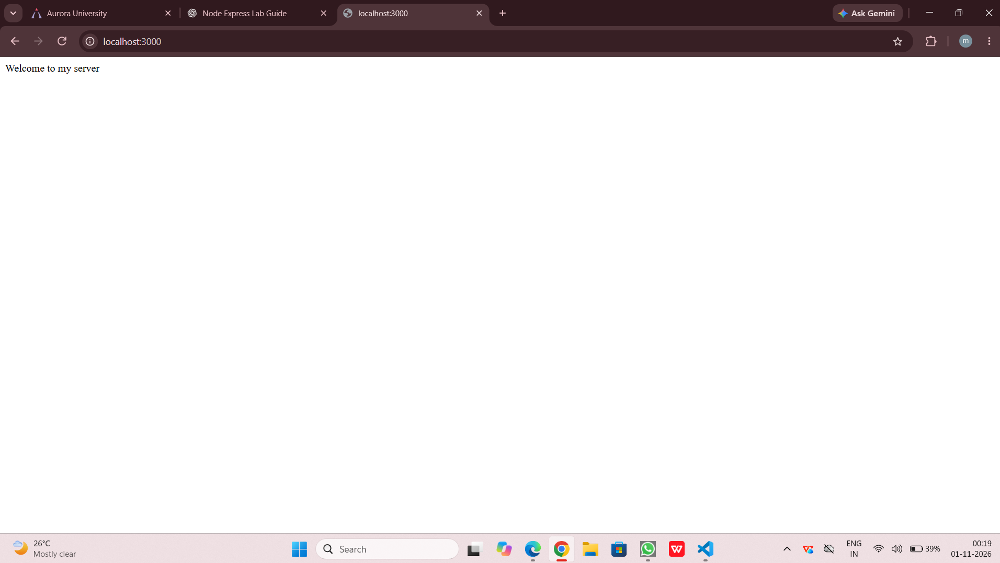
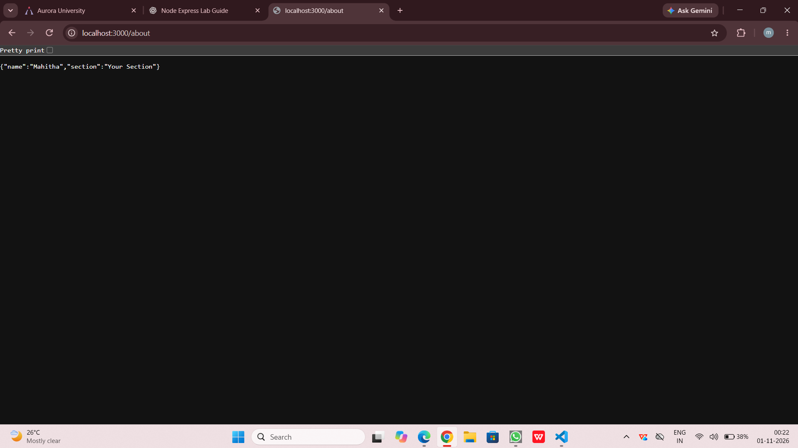
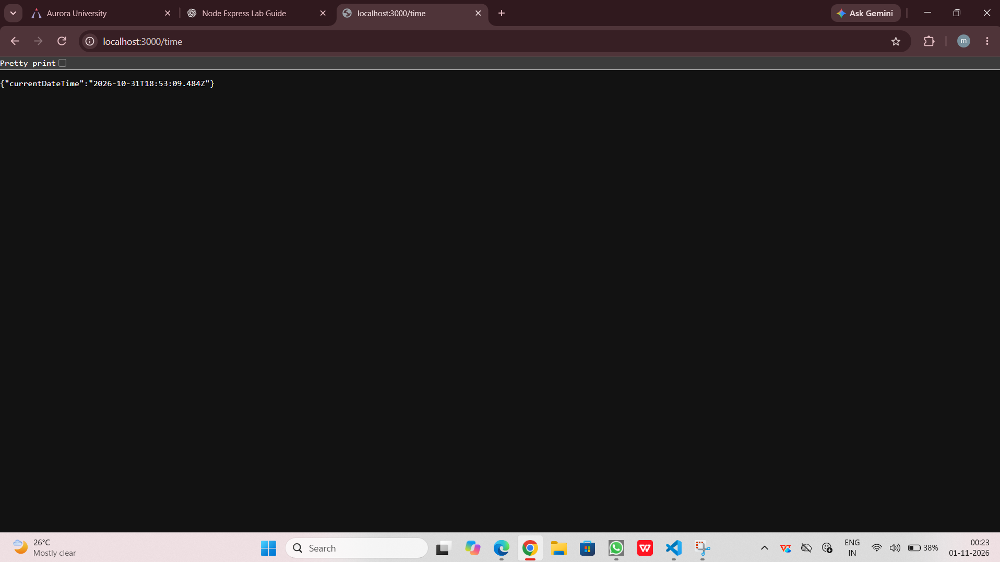
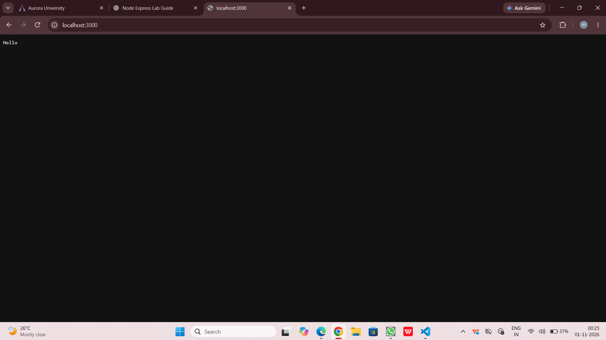

# Lab 1: Node.js and Express server

## Student Details
- Name: Mahitha
- Registration Number: YOUR REGISTRATION NUMBER
- Section: YOUR SECTION

## Objective
To create a basic HTTP server using Node.js and develop a web server using Express.js with multiple GET routes and appropriate HTTP status codes.

## Software Requirements
- Node.js
- npm
- Visual Studio Code
- Web Browser

## How to Run

1. Install Node.js.
2. Open the project folder in VS Code.
3. Open the terminal.
4. Install dependencies:

   npm install

5. Start the Express server:

   node app.js

6. Open the endpoints in a browser.

## Endpoints

| Method | Path | Description | Status |
|--------|------|-------------|--------|
| GET | / | Displays welcome message | 200 |
| GET | /about | Displays name and section in JSON | 200 |
| GET | /time | Displays current date and time | 200 |
| GET | /contact | Displays page not found message | 404 |

## Screenshots

### 1. Home Page

### 2. About Page

### 3. Time Page

### 4. 404 Page

### 5. Basic HTTP Server

## Problems Faced and Solutions
- Missing Express package: Solved by running npm install express.
- Port already in use: Stopped the previous server before restarting it.

## Conclusion
Successfully created a basic HTTP server using Node.js and an Express server with multiple GET routes. Tested the endpoints and verified their HTTP status codes.
