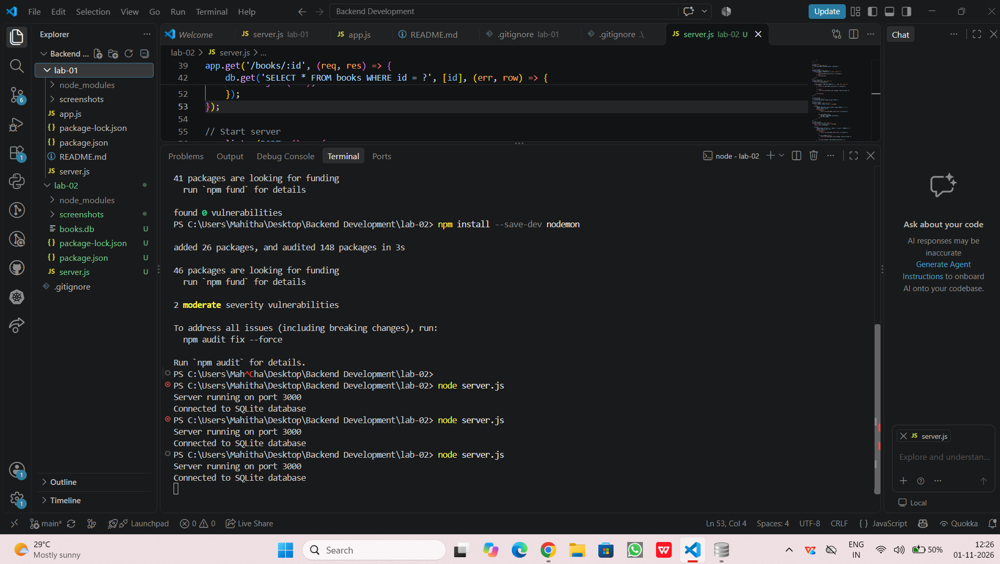
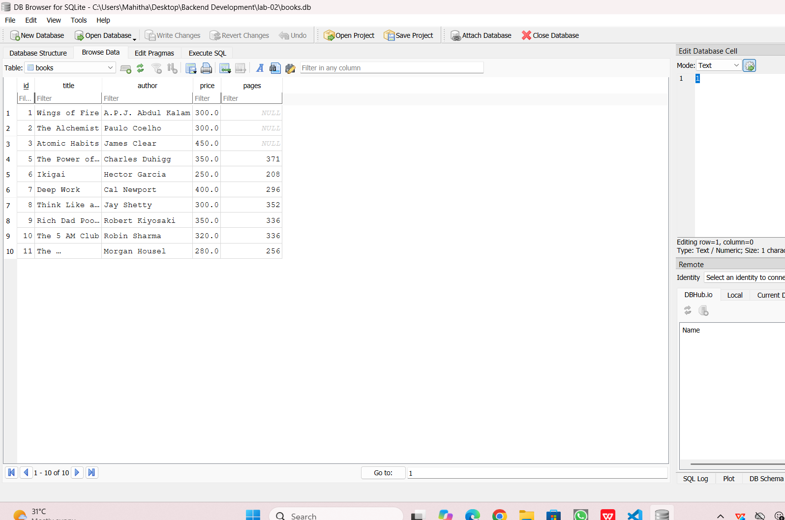
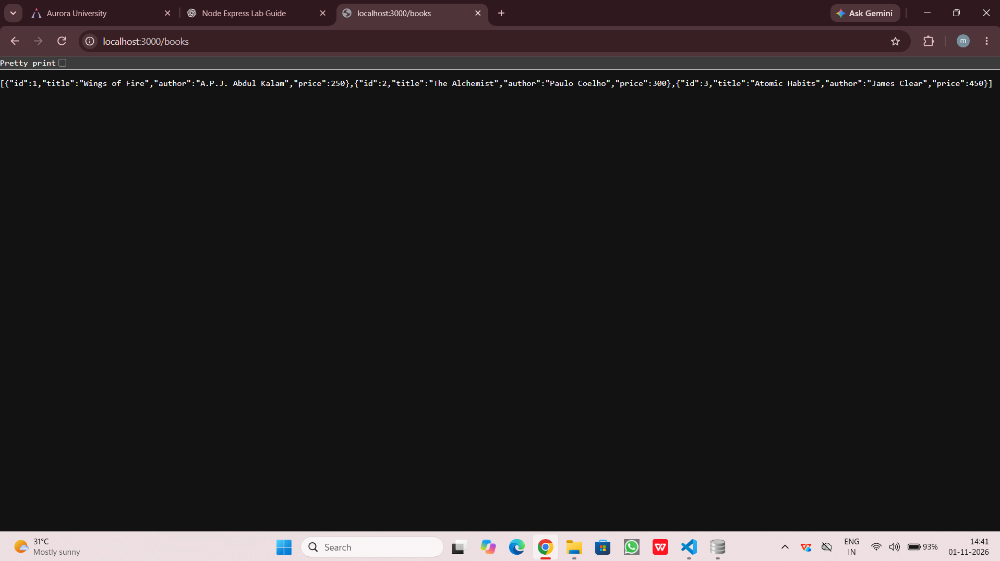
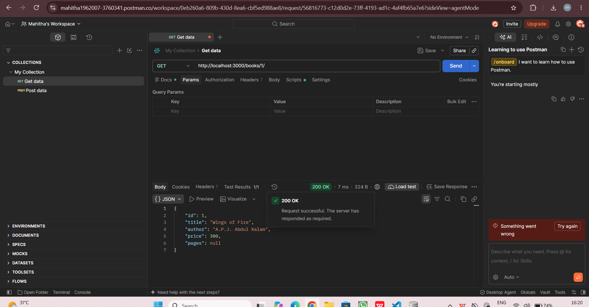
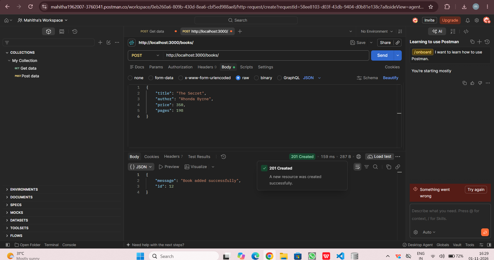
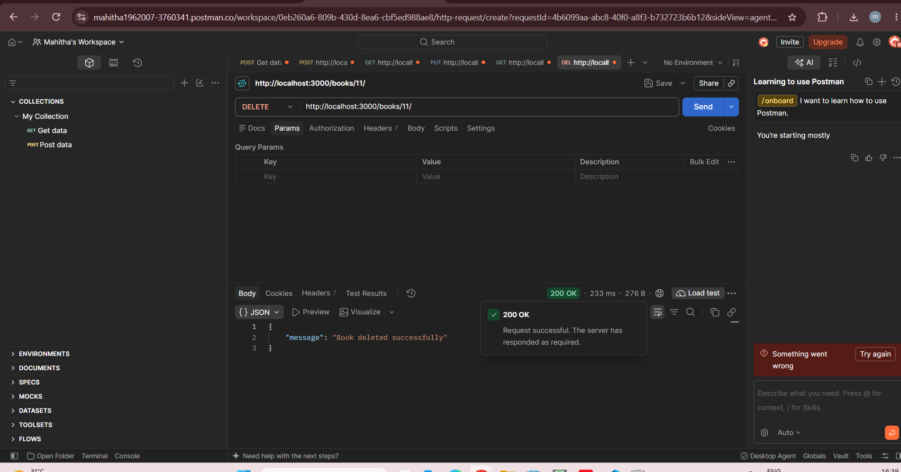

# Lab 2: SQLite Database and CRUD Routes

## Student Details
- Name: Mahitha Penta
- Registration Number: [252U1R5121]
- Section: [AIDE-2B]

## Objective
To connect an Express server to an SQLite database and implement CRUD operations through HTTP routes.

## Technologies Used
- Node.js
- Express.js
- SQLite
- JavaScript
- Postman
- DB Browser for SQLite

## Installation

Install the required packages:

npm install

## How to Run

Start the development server using:

npm run dev

Server URL:
http://localhost:3000

## Database Details

Database: books.db
Table: books

Columns:
- id
- title
- author
- price
- pages

## API Endpoints

| Method | Path | Description |
|---|---|---|
| GET | /books/ | Retrieve all books |
| GET | /books/:bookId/ | Retrieve a book by ID |
| POST | /books/ | Add a new book |
| PUT | /books/:bookId/ | Update a book |
| DELETE | /books/:bookId/ | Delete a book |

## Screenshots

### Project Structure

### Database Records

### GET All Books

### GET Single Book

### POST Book

### PUT Book

### DELETE Book

### Database Verification

## Deployment
## Deployment

Platform: Render

Live URL: https://lab-02-books-api.onrender.com

The application is deployed successfully on Render.

## Problems Faced and Solutions
1. Postman Cloud Agent could not access localhost. This was resolved by switching to the Desktop Agent.
2. The database table was updated to include the pages column.
3. Nodemon was configured to restart the server automatically during development.

## Conclusion
Successfully connected an Express server to an SQLite database and implemented five CRUD operations using parameterized SQL queries and asynchronous functions.